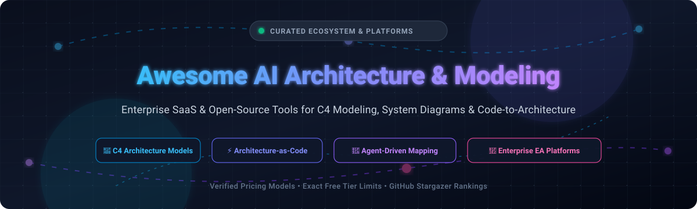
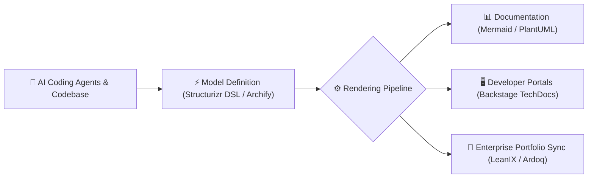

# Awesome-AI-Architecture-Modeling 📐

  
  
  
  
  
  
  

<h3>Curated Directory of Software Architecture, C4 Modeling, System Diagramming &amp; AI-Assisted Architecture Platforms</h3>

  <strong>A comprehensive index of enterprise SaaS solutions and open-source architecture-as-code ecosystems with verified starting prices, exact free tier limitations, company scale, and GitHub star rankings.</strong>

---

## 📌 Table of Contents
- [🌐 Sector Overview & Market Dynamics](#-sector-overview--market-dynamics)
- [🏢 Enterprise SaaS & Hosted Platforms](#-enterprise-saas--hosted-platforms)
- [💻 Open-Source GitHub Projects](#-open-source-github-projects)
- [🛠️ Architectural Workflow & Best Practices](#️-architectural-workflow--best-practices)
- [🤝 How to Contribute](#-how-to-contribute)
- [💖 Support & Sponsor](#-support)
- [📈 Star History](#-star-history)
- [⚖️ Disclaimer](#️-disclaimer)

---

## 🌐 Sector Overview & Market Dynamics

The global enterprise architecture (EA) and software modeling software market is currently valued at approximately **$1.2 billion to $1.3 billion** and is projected to expand toward **$2.3 billion** over the next decade at a CAGR of roughly **6.5% to 7%**. 

The sector is **moderately fragmented** with steady ongoing private equity consolidation (such as Main Capital Partners merging Bizzdesign, MEGA International, and Alfabet into a single €110M+ platform, and SAP acquiring LeanIX for ~$1.2B). Rather than a winner-take-all environment, the ecosystem remains bifurcated between heavy governance-focused enterprise suites for application portfolio management (APM/EA) and agile, developer-centric diagramming tools specializing in **C4 modeling**, **architecture-as-code (AaC)**, and **AI agent-driven diagramming**.

---

## 🏢 Enterprise SaaS & Hosted Platforms

> [!NOTE]  
> All platforms below are ranked in descending order by estimated company valuation / annual revenue scale.

| Platform | Company Size (Valuation / Revenue) | Pricing (Starting Paid Tier) | Free Tier Limits / Free Trial Plan | Key Focus & Modeling Capabilities |
| :--- | :--- | :--- | :--- | :--- |
| **[Lucidchart](https://www.lucidchart.com/)** | **$3B+ Valuation** (~$200M+ ARR) | **$9.00 / month** (Individual plan, billed annually) | **Free Forever Plan**: 3 editable documents, max 60 shapes/objects per document, 100 basic templates | Cloud collaborative visual diagramming platform for system maps, flowcharts, cloud architectures, and UML |
| **[LeanIX (SAP)](https://www.leanix.net/)** | **$1.2B Acquisition** (~$100M ARR) | **~$30,000 / year** starting enterprise contract (based on application count) | **No Free Tier / No Self-Serve Trial**: Guided enterprise demo and customized Proof-of-Concept (PoC) only (unlimited users included) | Enterprise architecture management (EAM), application portfolio rationalization, and technology roadmapping |
| **[Bizzdesign](https://bizzdesign.com/)** | **€110M Combined ARR** (Backed by Main Capital) | **~€5,000 / year** starting implementation (~£5 to £3,600+/designer seat/yr) | **No Self-Serve Free Trial**: Request-a-demo and guided pilot PoC model only; free access to introductory eLearning academy | Enterprise architecture governance, ArchiMate modeling, business capability mapping, and strategic portfolio management |
| **[Ardoq](https://www.ardoq.com/)** | **$300M+ Valuation** (~$35M+ ARR) | **~$15,000 to $20,000 / year** starting contract (scaled by application portfolio count) | **No Self-Serve Free Trial**: Custom guided pilot / Proof-of-Concept coordinated via sales with unlimited organizational viewer seats | Data-driven enterprise architecture, automated system dependency graphing, and dynamic scenario modeling |
| **[Enterprise Architect](https://sparxsystems.com/)** | **$5M+ Annual Revenue** (Over 1M+ active users) | **$229 per license** (Perpetual desktop Professional Edition standard license) | **30-Day Free Trial**: 30-day evaluation period with all edition features enabled; exports diagrams with an embedded watermark | Comprehensive desktop modeling suite supporting UML 2.5, SysML, ArchiMate 3, BPMN, and TOGAF frameworks |
| **[Cloudcraft (Datadog)](https://www.cloudcraft.co/)** | **Acquired by Datadog** (Part of $45B+ public company) | **$40.83 / user / month** (Pro plan billed annually at $490/yr; or included free with Datadog subscriptions) | **Free Forever Plan**: 1 user, manual diagram creation only (live AWS/Azure/GCP cloud auto-scanning and sync disabled) | 3D isometric & 2D cloud architecture diagramming with automated AWS/Azure account inventory and cost estimations |
| **[IcePanel](https://icepanel.io/)** | **$3.5M ARR** (YC W23 alumnus, bootstrapped) | **$40 / editor / month** (Growth plan billed annually at $480/yr) | **Free Forever Plan**: Up to 5 editors, unlimited viewers, max 100 model objects, unlimited diagrams, 2 tag groups, 1 flow/diagram | Interactive, zoomable collaborative visual architecture modeling built explicitly around the C4 model for agile teams |
| **[Eraser.io](https://www.eraser.io/)** | **$4M Seed Funded** (Multi-million ARR) | **$15 / user / month** (Starter plan billed annually at $180/yr) | **Free Forever Plan**: 3 active docs/files, 3 AI diagram generation credits, 7-day version history, unlimited viewers/guests | Hybrid technical documentation canvas combining code-to-diagram generation, AI flowcharting, and markdown notes |
| **[Visual Paradigm](https://www.visual-paradigm.com/)** | **Private / Bootstrapped** (Hundreds of thousands of users) | **$6.00 / month** (Modeler subscription, or $99 perpetual license) | **Free Forever Edition**: Desktop Community Edition free forever for non-commercial use with watermark; Web Free Edition with 1 GB cloud storage | Enterprise modeling suite covering UML, BPMN, ERD, ArchiMate, customer journey maps, and TOGAF enterprise architecture |
| **[Structurizr Server](https://structurizr.com/)** | **Independently Operated** (Pioneered by Simon Brown) | **£300 / month** (Pre-built server, billed annually for up to 20 users) | **Free Forever (Build from Source)**: Open-core server source code is free to host locally; 14-day trial for pre-built enterprise server | Commercial self-hosted web server and visualization workspace specifically designed for the C4 model & Structurizr DSL |

---

## 💻 Open-Source GitHub Projects

> [!NOTE]  
> All repositories below are ordered in descending order by **GitHub Stars_Count**. Every badge links directly to that repository's stargazers page.

| Repository | GitHub_Stars_Badge | Primary Language / Engine | Description |
| :--- | :--- | :--- | :--- |
| **[Excalidraw](https://github.com/excalidraw/excalidraw)** |  | TypeScript / React | Virtual collaborative whiteboard for sketching software architecture diagrams with an intuitive hand-drawn feel, rich component libraries, and AI diagramming tools. |
| **[Mermaid](https://github.com/mermaid-js/mermaid)** |  | JavaScript | Markdown-inspired text-to-diagram syntax engine natively supported in GitHub, GitLab, and Notion for generating flowcharts, sequence diagrams, and C4 models. |
| **[Archify](https://github.com/tt-a1i/archify)** |  | Python / HTML / JS | Autonomous agent skill that analyzes codebases, specifications, and architecture plans to generate interactive, self-contained HTML architecture and lifecycle maps. |
| **[Diagrams (mingrammer)](https://github.com/mingrammer/diagrams)** |  | Python / Graphviz | Diagram-as-code library enabling developers to design cloud system architectures (AWS, GCP, Azure, Kubernetes) directly via Python code without GUI tools. |
| **[Backstage](https://github.com/backstage/backstage)** |  | TypeScript / React | CNCF open-source developer portal platform created by Spotify for centralizing software catalogs, TechDocs, system architecture models, and service dependencies. |
| **[D2](https://github.com/d2lang/d2)** |  | Go | Declarative, modern diagramming language designed specifically for software architecture, featuring automated layout engines, multi-board views, and SQL/code snippets. |
| **[PlantUML](https://github.com/plantuml/plantuml)** |  | Java | Classical and battle-tested component that turns plain-text descriptions into UML diagrams, state charts, sequence diagrams, and C4 models across IDEs and CI/CD. |
| **[draw.io / diagrams.net](https://github.com/jgraph/drawio)** |  | JavaScript | Universal, privacy-first diagramming suite with desktop and web distributions supporting C4 templates, cloud infrastructure shapes, and offline workflows. |
| **[C4-PlantUML](https://github.com/plantuml-stdlib/C4-PlantUML)** |  | PlantUML | The definitive open-source PlantUML standard library implementing the C4 model (Context, Container, Component, and Code) with clean visual styling. |
| **[Kroki](https://github.com/yuzutech/kroki)** |  | Java / Docker | Unified multi-engine REST API and CLI that converts text descriptions into diagrams using Mermaid, PlantUML, Structurizr, D2, Graphviz, BlockDiag, and BPMN. |
| **[Gaphor](https://github.com/gaphor/gaphor)** |  | Python / GTK | Simple, standards-compliant desktop modeling environment implementing UML 2, SysML, RAAML, and C4 architecture diagrams. |
| **[Archi](https://github.com/archimatetool/archi)** |  | Java / Eclipse RCP | Open-source, cross-platform enterprise architecture modeling tool dedicated to the ArchiMate 3.2 open standard, widely used by enterprise architects globally. |
| **[Structurizr Java / DSL](https://github.com/structurizr/java)** |  | Java | The core library for the Structurizr models-as-code ecosystem, allowing developers to define system architecture programmatically and export to multiple formats. |
| **[C4-draw.io](https://github.com/tobiashochguertel/c4-draw.io)** |  | XML / draw.io | Comprehensive shape libraries, custom stencils, and reusable templates for drawing C4 software architecture diagrams inside draw.io / diagrams.net. |
| **[Structurizr CLI](https://github.com/structurizr/cli)** |  | Java | Command-line utility for working with Structurizr DSL files, running local validations, and exporting workspace definitions to PlantUML, Mermaid, and WebGL. |

---

## 🛠️ Architectural Workflow & Best Practices

Modern software engineering organizations combine tools from both worlds into an integrated **Architecture-as-Code (AaC)** pipeline:

1. **Model Once, Render Everywhere**: Maintain canonical system relationships in textual models (**Structurizr DSL**, **D2**, or **Archify**) rather than static binary files.
2. **Automate with CI/CD**: Hook diagram generation into pull request checks so system maps update alongside pull request code changes.
3. **Bridge Technical & Executive Views**: Use interactive tools like **IcePanel** or **Lucidchart** when communicating with non-technical stakeholders, while keeping version-controlled repositories in Git.

---

## 🤝 How to Contribute

Contributions are warmly welcomed! Help us keep this directory up-to-date and comprehensive:

1. 🍴 **Fork** this repository.
2. 🌿 Create a feature branch (`git checkout -b feature/new-tool`).
3. 📝 Add your entry ensuring:
   - For **SaaS platforms**: Include exact starting pricing, precise free-tier limits, company scale, and official website.
   - For **Open-Source projects**: Include repository URL, social Stars_Badge (`style=social&color=white`) linking to `/stargazers`, language, and clear description.
4. 🚀 Open a **Pull Request** with a brief summary of the added platform.

---

## 💖 Support

If you found this curated list helpful for your software engineering team or architecture practice:

- ⭐ **Star this repository** to show your support and make it easier for other architects to find!
- 🍴 **Fork and share** it with your engineering peers and tech communities.
- ☕ **Sponsor the Maintainer**: Support ongoing curation, open-source research, and development by buying a coffee via the [GitHub Sponsor Dashboard](https://github.com/sponsors/ishandutta2007).

---

##  Star Hsstory

---

## ⚖️ Disclaimer

- This repository is a **community-curated index** intended for educational and architectural research purposes.
- Product names, trademarks, and logos are properties of their respective owners. Inclusion does not imply official endorsement or affiliation.
- Architecture models and automated agent-generated diagrams should always be reviewed against real infrastructure, code repositories, and security baselines.

---

  Built with ❤️ for software architects, systems engineers, and open-modeling advocates worldwide.

